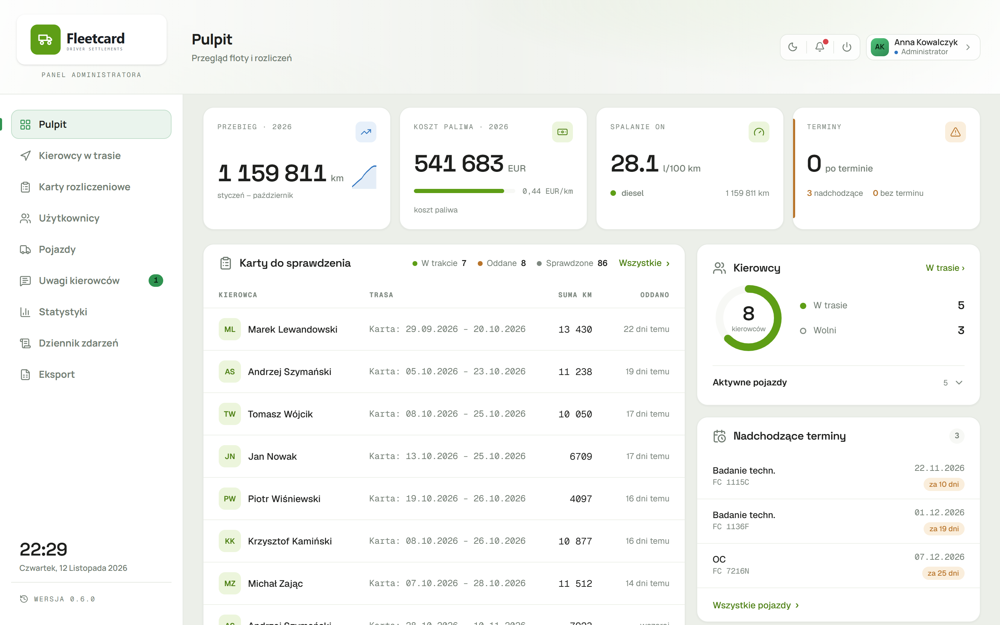
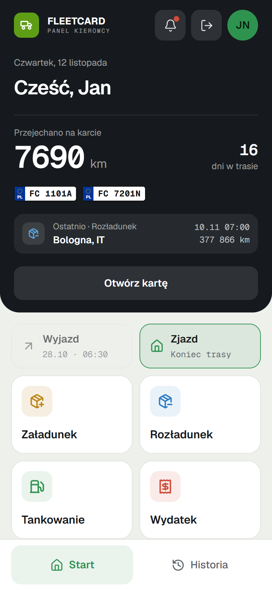
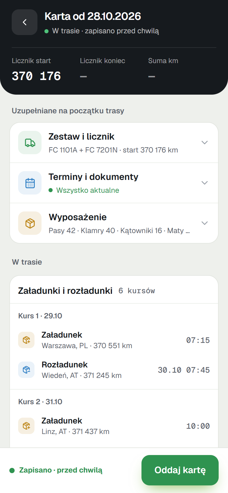
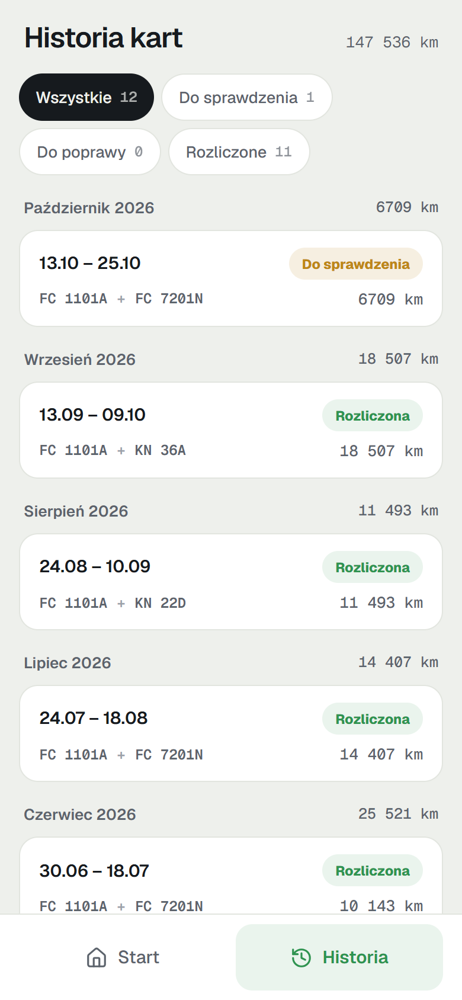
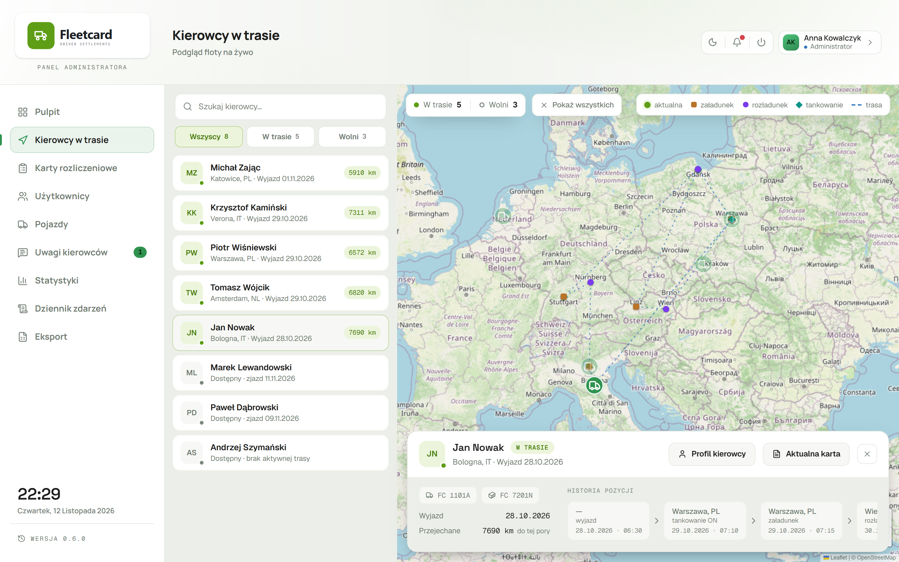
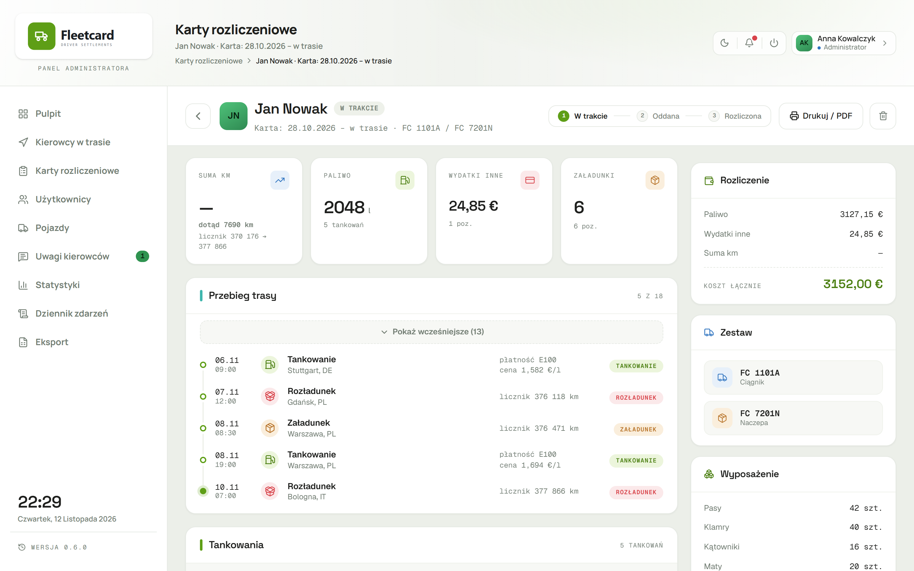
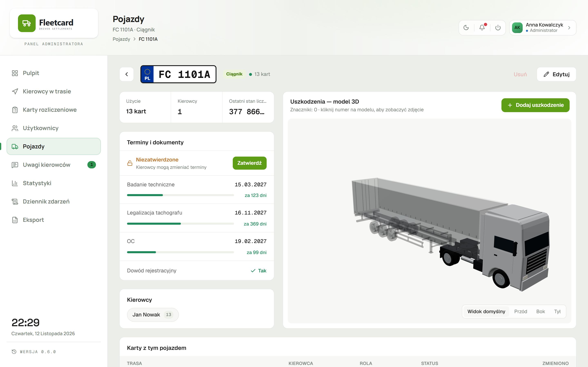
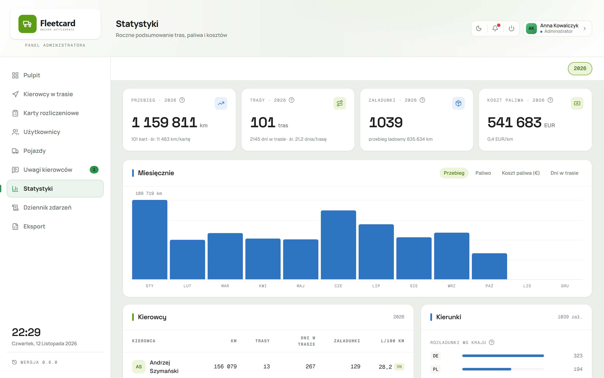
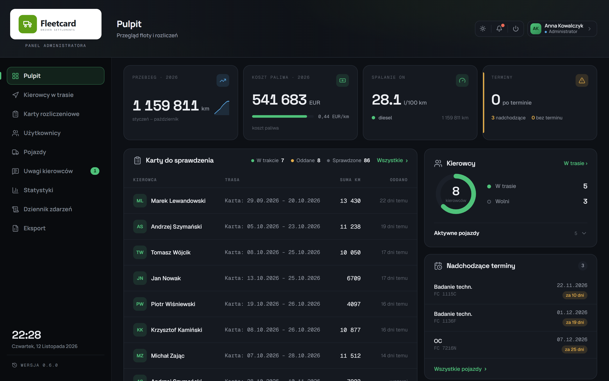
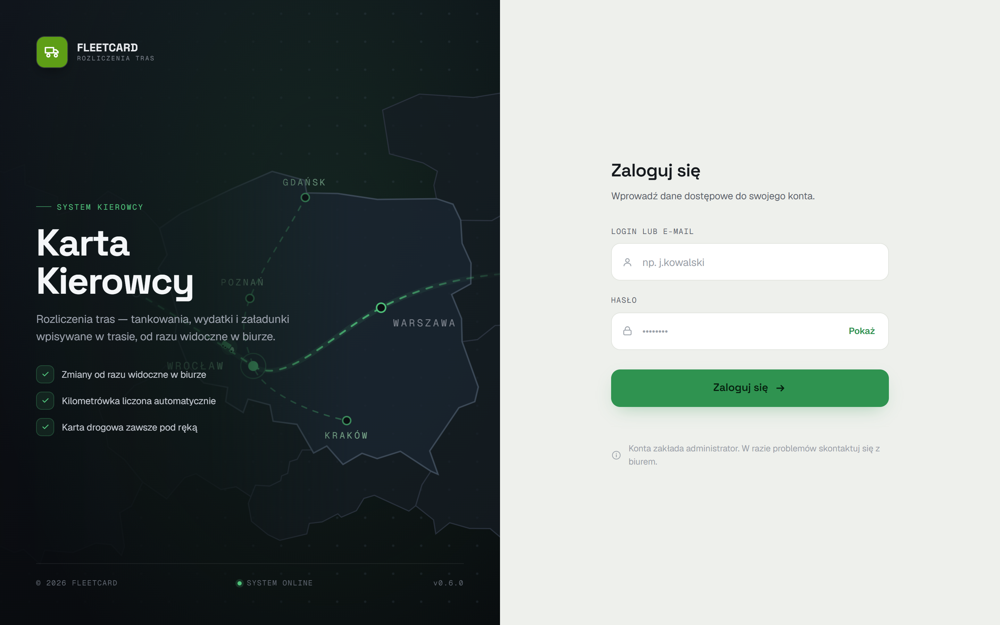

  

# Fleetcard — driver settlement cards for trucking fleets

A white-label PWA for freight and trucking companies: drivers fill in their settlement card (fuelings, expenses, departures, loadings) on the road, and the office tracks everything live in a back-office panel with print and Excel export.

Each company runs its **own instance** (its own Supabase project + static frontend), branded through a single config file. The UI is in Polish.

> **About this repository.** This is a public showcase: architecture, screenshots and selected source files. The full source code is kept in a private repository and is **available on request** — open an issue or contact me via my [GitHub profile](https://github.com/Maliaam).

> Built end-to-end by me and used in production by a Polish trucking company (~10–50 drivers). This repository is a de-branded showcase of that product.

## Screenshots

All screenshots use generated demo data — the people, plates and routes are fictional.

  

### Driver app (mobile)

  
  &nbsp;
  
  &nbsp;
  

### Admin panel

| Drivers on route — live map | Card preview — route timeline and costs |
|---|---|
|  |  |
| **Vehicle — deadlines and 3D damage model** | **Yearly statistics** |
|  |  |
| **Dark theme** | **Login** |
|  |  |

## Features

- **Driver app (mobile-first, Polish UI)**
  - Login with username or e-mail + password (no self-registration; usernames are mapped internally to a synthetic e-mail for Supabase Auth)
  - Monthly settlement card: header (tractor, up to 4 trailers incl. external "KN" trailers, odometer start/end), vehicle documents & deadlines, equipment counts, and four dynamic tables — fuelings, other expenses, departures/returns, loadings/unloadings
  - "Now" button to stamp current date/time into rows; per-row currency (fuelings and expenses)
  - Optimistic autosave: drafts stored in IndexedDB (Dexie) with a dirty-flag retry queue, debounced writes to Supabase via an atomic `save_card` RPC
  - "Submit card" flow: server requires final odometer; a submitted card is locked for the driver
  - Light/dark theme, installable PWA with offline asset caching (service worker)
- **Admin panel** (roles: `administrator`, `dyspozytor`, `biuro`; drivers have no panel access)
  - Dashboard with KPI tiles, live-updating via Supabase Realtime (`postgres_changes`)
  - Cards list (all drivers) with pagination, card preview with status bar (draft → submitted → processed), route timeline, and review comments
  - "Drivers on route" view: per-driver accordion cards with route history and a Leaflet map fed by a static city gazetteer (no GPS)
  - User management: create/edit accounts, change roles, soft-ban (`banned_until`), permanent delete (only when the user has no cards)
  - Vehicle registry (tractors/trailers) with document deadlines, editable by drivers only through a restricted `SECURITY DEFINER` RPC
  - Audit log: server-written history of account actions, card status changes, and card edits (with before/after values), searchable, paginated, exportable to CSV
  - Statistics: yearly fleet summary — monthly mileage/fuel/costs chart, per-driver totals, unload destinations by country, mileage per tractor, costs per payment card
  - Print view: A4 card printout / save as PDF
  - Excel export (SheetJS): cards, vehicles, users, audit log datasets
  - Client error reporting to a `client_errors` table (rate-limited on both client and server)
  - Vehicle damage photos pinned to an interactive 3D truck model (client-side resize + EXIF/GPS stripping before upload, private storage bucket)
  - Notifications sent from the panel to drivers, with per-user notification preferences
  - Driver feedback inbox (drivers send short notes, the office reviews them)
  - In-app changelog
- **Backend (Supabase)**
  - Normalized Postgres schema, Row Level Security from day one (drivers see only their own draft cards; staff read everything)
  - Server-side logic in SQL RPCs: atomic card save, `km_total` calculation and validation, user provisioning (`admin_create_driver`), audit triggers
  - Private `vehicle-photos` storage bucket with RLS (drivers manage their own photos, staff read all)
  - Roles read only from server-controlled `app_metadata`; function grants hardened explicitly

## Tech Stack

- **Language:** TypeScript (strict, everywhere)
- **Frontend:** React 19, Vite 8, React Router 7, Tailwind CSS 4, `vite-plugin-pwa` (Workbox), lucide-react icons, Fontsource fonts (Geist, Space Grotesk, Manrope, Geist Mono)
- **Backend:** Supabase — Postgres, Auth, Realtime, Row Level Security, Storage
- **Offline buffer:** Dexie.js (IndexedDB)
- **Maps:** Leaflet (lazy-loaded) with a hand-maintained static gazetteer
- **Export:** SheetJS (`xlsx`)
- **Hosting:** static SPA (Vercel rewrite config included; Cloudflare Pages targeted), Supabase for the backend

## Architecture

The app is a single React SPA that talks directly to Supabase — there is no custom API server; all server-side logic lives in Postgres functions (RPCs) and RLS policies, so the client is never trusted for validation or authorization. Routing splits by role after login: drivers get the card-editing app, staff get the admin panel, and the admin panel keeps itself fresh by subscribing to Realtime `postgres_changes`. Card editing is online-first with a thin offline net: every keystroke is autosaved to IndexedDB, and a debounced, atomic `save_card` RPC pushes the whole card (header + child rows) to Postgres, with a dirty-flag queue retrying failed writes when the connection returns (last-write-wins, no CRDT). One card belongs to one driver, edits are locked server-side once the card is submitted, and every change is recorded in an audit log written exclusively by server functions.

More detail — data model, request flow and the security model — in [docs/architecture.md](docs/architecture.md).

## Code samples

Selected files from the private repository, unchanged (comments are in Polish — a short English guide is in [excerpts/README.md](excerpts/README.md)):

| File | What it shows |
|---|---|
| [`offline-sync/useCardEditor.ts`](excerpts/offline-sync/useCardEditor.ts) | Optimistic editing: instant IndexedDB autosave + debounced server save, recovery on reconnect |
| [`offline-sync/cardSync.ts`](excerpts/offline-sync/cardSync.ts) | Retry queue and error classification (expired session vs. locked card vs. bad data vs. no network) |
| [`offline-sync/db.ts`](excerpts/offline-sync/db.ts) | Dexie schema of the offline buffer |
| [`database/save_card.sql`](excerpts/database/save_card.sql) | Atomic card save RPC: upsert + replace child rows in one transaction, with a field-level audit diff |
| [`database/guard_card_driver_columns.sql`](excerpts/database/guard_card_driver_columns.sql) | RLS + trigger so a driver can never set office-owned fields, whatever the client sends |

## White-label

One deployment = one company with its own database (no `company_id`, full data isolation, simple RLS). Branding — name, legal name, tagline, logo and mark — is read from one config module and optional `VITE_BRAND_*` environment variables, so no component hard-codes a company name.

## What I Learned

- **Online-first beats offline-first for this scale.** Drivers almost always have connectivity, so a full sync engine/CRDT would be over-engineering — a Dexie autosave with a dirty-flag retry queue and last-write-wins covers the real failure mode (a tunnel, a dead spot) at a fraction of the complexity.
- **Push logic into Postgres, not a backend service.** RLS policies plus `SECURITY DEFINER` RPCs (atomic card save, user provisioning, restricted vehicle-doc edits) made a separate API server unnecessary, but they demand discipline: every function's grants had to be hardened explicitly, and audit rows are only writable by server functions.
- **Supabase Auth has sharp edges when provisioning users via SQL.** GoTrue reads token columns as non-null strings — inserting `auth.users` rows with `NULL` tokens causes 500s at login, so the provisioning RPC must set them to `''`. Username login also required mapping logins to a synthetic internal e-mail domain.
- **Realtime needs schema-level cooperation.** Live admin views required `REPLICA IDENTITY FULL` and explicit publication setup in migrations, not just a client-side subscription.
- **A "monthly" document is a label, not a data boundary.** Long hauls span months, so the card keeps its month/year purely as a label while real dates live in the rows — modeling that early avoided painful reporting queries later.

## License

Copyright © 2026 Adam Malinowski. All rights reserved. The materials in this repository are published for portfolio purposes only — see [LICENSE](LICENSE).
