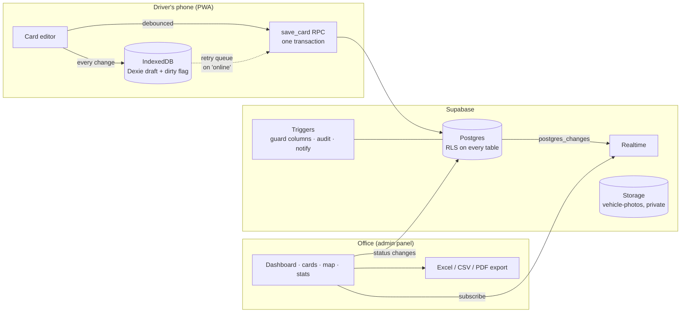

# Architecture

Fleetcard is a single React SPA (PWA) that talks **directly to Supabase**. There is no custom API server: authorization lives in Row Level Security policies, and every non-trivial write goes through Postgres functions (RPCs) and triggers. The client is treated as untrusted.

## Overview

## Editing flow (online-first, thin offline net)

1. Every keystroke updates React state and is written **immediately** to IndexedDB with `dirty = 1`.
2. A debounced call sends the **whole card** (header + all child rows) to the `save_card` RPC, which upserts the header and replaces child rows in one transaction.
3. On success the local draft is marked clean — but only if nothing newer was typed while the request was in flight (compared by `updatedAt`).
4. Failures are classified, because retrying is not always right:
   - **expired session** → keep the draft queued until the user logs in again;
   - **card locked** (submitted or deleted from the panel meanwhile) → reload from the server and make the form read-only;
   - **rejected data** (SQLSTATE class 22/23) → keep the draft for the driver to fix, without blocking other cards in the queue;
   - **no network** → stop and retry when the browser fires `online`.

One card belongs to one driver, so conflicts are resolved by **last-write-wins**; a full sync engine or CRDT would be over-engineering at this scale.

## Data model

| Table | Purpose |
|---|---|
| `drivers` | Profile linked 1:1 to `auth.users`, with a role (`kierowca`, `administrator`, `dyspozytor`, `biuro`) |
| `vehicles` | Tractors and trailers with document deadlines (inspection, insurance, tachograph) |
| `cards` | Settlement card: driver, period label, tractor, odometer, status `draft → submitted → processed` |
| `card_trailers` | Up to 4 trailers per card — fleet trailers or external plates typed in by the driver |
| `fuelings`, `expenses`, `departures`, `loadings` | Child rows of a card, ordered by `position` |
| `audit_log` | Server-written history of account actions, status changes and field-level card edits |
| `vehicle_photos` | Damage photos pinned to a point on a 3D vehicle model |
| `notifications`, `notification_prefs` | Messages from the office to drivers + per-user preferences |
| `driver_feedback` | Short notes from drivers to the office |
| `client_errors` | Rate-limited client error reports |

The month/year of a card is a **label, not a data boundary** — long hauls span several months, so real dates live in the rows.

## Security model

- **RLS everywhere.** Drivers see only their own cards and can write only while the card is a `draft`; child-row policies check ownership through the parent card. Staff roles read everything.
- **Server-owned columns.** A `BEFORE INSERT/UPDATE` trigger overwrites office-owned fields (submission time, review comment, trip range) for non-admins, whatever the client sends.
- **Server-side calculations.** `km_total`, the trip date range and validation (e.g. final odometer required on submit) are computed in Postgres.
- **Roles from server-controlled metadata only.** User-editable metadata never decides a role; accounts are provisioned by an admin-only RPC (there is no public sign-up).
- **Hardened functions.** Functions have a fixed `search_path`, and `EXECUTE` is explicitly revoked from `anon` / `public` where not needed; trigger functions are not callable over REST.
- **Private storage.** Photos are resized in the browser and stripped of EXIF/GPS before upload to a private bucket.

## Realtime

`cards`, all child-row tables, `audit_log`, `notifications` and `driver_feedback` are in the `supabase_realtime` publication with `REPLICA IDENTITY FULL`, so the admin panel can filter changes by `card_id` and refresh itself without polling.
